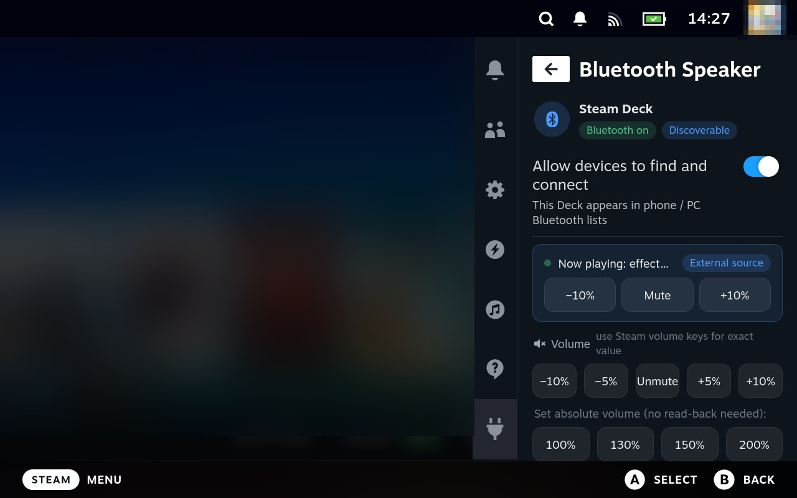
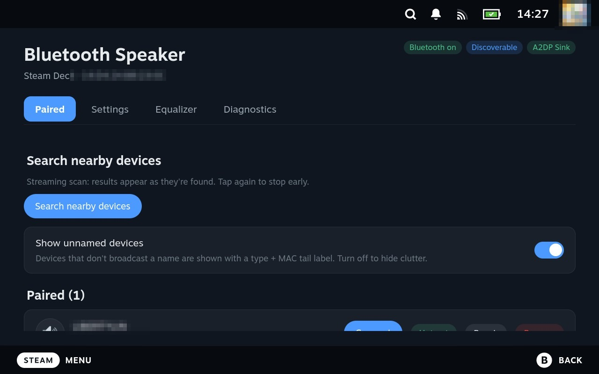
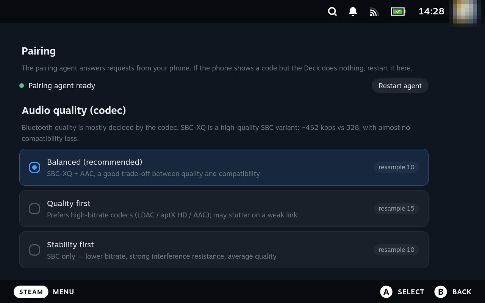
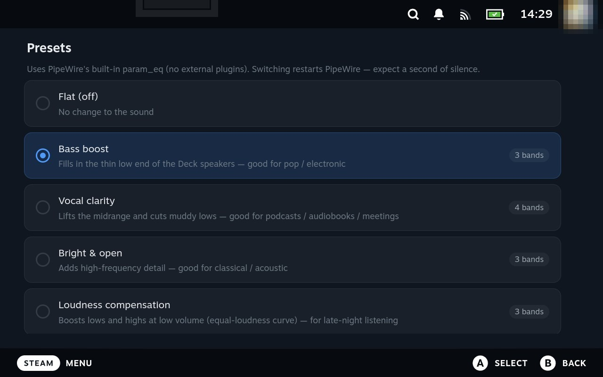
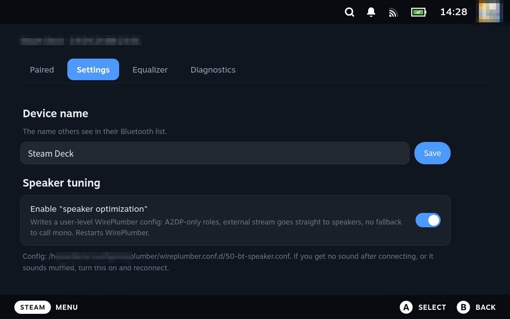
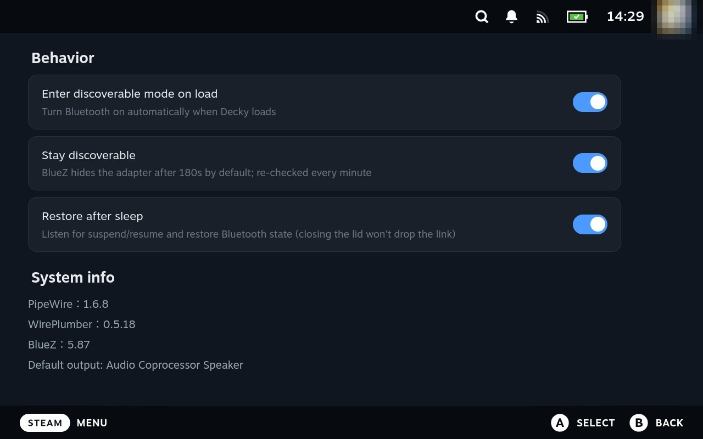

# Bluetooth Speaker · Steam Deck Decky Loader Plugin

**English** · [简体中文](#简体中文)

> **Turn your Steam Deck into a *usable* Bluetooth speaker and audio hub.**
> Phones, tablets and PCs connect and play music straight out of the Deck's surprisingly good stereo speakers.

[](CHANGELOG.md)
[](LICENSE)
[](https://store.steampowered.com/steamos)

---

## Why this exists

Since SteamOS 3.7, a Deck **can already** act as a Bluetooth speaker — just pair manually ([Xe Iaso's writeup](https://xeiaso.net/notes/2026/steam-deck-bluetooth-speaker/)). WirePlumber's `bluez5.roles` includes `a2dp_sink` by default.

But four things get in the way:

| Problem | Consequence | What this plugin does |
|---|---|---|
| `DiscoverableTimeout` defaults to 180s | Your phone loses the Deck after 3 minutes | Set to 0, re-checked every minute |
| HFP/HSP steals A2DP | Opening a mic drops the whole stream to mono — sounds muffled, like a phone call | Disable `autoswitch-to-headset-profile` |
| Dual-role devices negotiate `audio-gateway` | **Connects but no sound** ([wireplumber#969](https://gitlab.freedesktop.org/pipewire/wireplumber/-/work_items/969)) | Narrow `bluez5.roles` to A2DP only |
| `bluez5.hw-volume` excludes `a2dp_sink` by default | Receiver gets no Bluetooth hardware volume | Explicitly added |

**None of the 118 Decky Store plugins does "Deck receives audio"** (GitHub search for `decky a2dp` / `decky bluetooth sink` returns zero). Existing plugins all do "Deck sends audio out" or "adjust the Deck's own audio".

This plugin fills that gap.

---

## Screenshots

All captured on a real Steam Deck (1280x800, English UI). Privacy details
(adapter MAC, paired device name, home path, Steam avatar) are pixelated.

| QAM panel | Devices & pairing |
|---|---|
|  |  |

| Codec & latency | Equalizer |
|---|---|
|  |  |

| Settings | Behavior & system info |
|---|---|
|  |  |

> Full list with descriptions: [docs/screenshots/README.md](docs/screenshots/README.md)

---

## Features

### Core

- **One switch to become a speaker** — Bluetooth on, discoverable, pairing agent ready
- **PIN-free pairing** — a resident `NoInputNoOutput` agent; one tap on your phone
- **Discoverability keep-alive** — `DiscoverableTimeout = 0` plus a per-minute re-check
- **Device management** — paired list, connect / disconnect / remove, rename
- **Volume control** — relative-step buttons (`wpctl set-volume N%+`), no read-back needed
- **Zero root** — only ships with system tools (`bluetoothctl` / `busctl` / `wpctl`), `flags: []`

### Handheld-specific

- **Survive suspend, restore on resume** — close the lid, open it, Bluetooth state is not lost
  - Snapshot `powered` / `discoverable` / connected devices before sleep
  - On resume: power on → restart agent → restore discoverable → reconnect devices
  - Listens to logind's `PrepareForSleep` via `busctl` / `gdbus` — **not** `dbus-monitor --system`, which needs root for `BecomeMonitor`
- **Screen off, music still playing** — turn the panel off while the Deck acts as a speaker
  - Takes a logind **suspend inhibitor lock** (`systemd-inhibit --what=idle:sleep`)
    so the idle timer can't put the whole machine to sleep and drop the audio link
  - Never inhibits `handle-power-key` / `handle-lid-switch` — the power button and lid keep working normally
  - Second line of defence: while the screen is off, the connected device is checked every 15s and reconnected if it dropped
  - Three ways to wake: any key / touch / **gamepad** (Steam routes gamepad input through `NavigationManager`, not DOM events)
  - Auto-restore after 5 minutes no matter what, plus restore-on-unload
  - **How the screen actually goes dark**: on the Deck OLED there is **no sysfs way
    to truly turn the panel off**. `brightness = 0` is clamped by the kernel, and
    `bl_power` is root-only *and ignored by the driver even after `chmod a+w`*
    (verified on hardware). So the plugin dims the backlight as far as it goes and
    paints a full-black overlay lifted into Steam's `UIComposition` layer — on OLED
    black pixels emit nothing, which is equivalent to off. An earlier version
    offered a "fix permission" button for `bl_power`; it was removed in v2.8.1
    because following it could never work.

### Audio experience

- **"Who's playing" live display** — detects the `bluez_input` node and shows the source device
- **Independent external-source volume** — adjust the phone stream **without touching game audio**
- **AVRCP metadata** — title / artist / album / position / playback state (the Deck screen is no longer blank)
- **Audio focus policy** — coexist with game / receiver-first / manual
- **Codec visibility** — shows whether you're on SBC / SBC-XQ / AAC / LDAC / aptX
- **Latency profiles** — low 60ms / balanced 120ms / anti-stutter 240ms
- **Auto-disconnect on silence** — cleans up when your phone forgets to disconnect (saves battery, stops swallowed notifications)
- **Volume normalization** — records a baseline and flags jumps over 25%

### Equalizer

- **5 presets** — flat / bass boost / vocal clarity / bright / loudness compensation
- **AutoEQ / Squiglink import** — paste a `ParametricEQ.txt`
- Uses PipeWire's **built-in** `param_eq`, zero external plugin dependencies
- A `clamp` limiter is chained after the EQ to prevent clipping (the built-in zero-latency hard limiter)

### Multi-output

- **Synchronized multi-output** — internal speakers + Bluetooth headset + wired headset at once (`combine-stream`)

### Diagnostics

- **12 self-checks** — from "adapter detected" to "all backend modules loaded", explicit ✅/❌
- **One-tap diagnostic report** — plain text, paste it straight to the author
- Raw adapter info, `wpctl status`, plugin log
- **Wi-Fi interference detection** — flags 2.4 GHz Wi-Fi, the #1 cause of Bluetooth audio stutter

---

## Install

### Decky Store / ZIP (recommended)

1. Decky settings → Developer → enable **Developer Mode**
2. **Install Plugin from ZIP** → pick `decky-bt-speaker.zip`
3. Back in the QAM, **Bluetooth Speaker** appears in the plugin list

### SSH push

```bash
pnpm install && pnpm run build
python pack.py

scp ../decky-bt-speaker.zip deck@steamdeck:~/
ssh deck@steamdeck
unzip -o ~/decky-bt-speaker.zip -d ~/homebrew/plugins/
sudo systemctl restart plugin_loader
```

### Local development

```bash
pnpm install
pnpm run watch          # rebuild on change
python tests_offline.py # backend self-tests (no Deck needed)
python pack.py          # package the zip
```

---

## Usage

1. QAM (`···`) → **Bluetooth Speaker** → turn on **Allow devices to find and connect**
2. Full page → **Settings** → enable **Speaker optimization** (writes the WirePlumber config once)
3. Search `Steam Deck` in your phone's Bluetooth settings and pair
4. Play music — it comes out of the Deck
5. Want to change the tone? Full page → **Equalizer** → pick a preset

> 💡 For the first pairing, try Desktop Mode. On some phones (iOS especially) the pairing dialog can be hidden behind the Steam UI in Game Mode.

### Pairing from the plugin

Full page → **Paired** tab → **Search nearby devices** (20s scan) → tap **Pair**. No need to leave the plugin for the system Bluetooth settings.

If pairing fails with "incorrect PIN or passkey", tap **Repair** — it clears the stale bond key on the Deck side and re-pairs.

---

## How it works

```
Phone / PC                          Steam Deck (SteamOS)
┌──────────┐   A2DP (SBC/AAC)   ┌──────────────────────────────┐
│ Music app│ ─────────────────▶ │ BlueZ ──▶ PipeWire           │
└──────────┘   2.4 GHz BT        │   bluez_input.<MAC> node     │
                                  │        │                     │
                                  │        ▼                     │
                                  │  default sink (speakers)     │
                                  └──────────────────────────────┘
```

> **Direction matters**: when the Deck **is the speaker**, the node is `bluez_input.*` (external stream coming in). When the Deck **connects to headphones**, it's `bluez_output.*`.

| Layer | What's used | Purpose |
|---|---|---|
| Adapter | `bluetoothctl` / `busctl set-property` | Power, discoverable, rename, `DiscoverableTimeout=0` |
| Pairing | Resident `bluetoothctl --agent=NoInputNoOutput` | PIN-free |
| Devices | `bluetoothctl devices/info/connect/disconnect/remove` | List and connection management |
| Volume | `wpctl set-volume` (relative `N%+`) | Works without reading current value |
| Metadata | `busctl get-property org.bluez ... MediaPlayer1` | Track info |
| Suspend | `busctl monitor` / `gdbus monitor` | Resume restore |
| Keep awake | `systemd-inhibit --what=idle:sleep --mode=block` | Bluetooth survives while the screen is off |
| EQ | `libpipewire-module-filter-chain` + `param_eq` + `clamp` | Equalizer with anti-clipping |
| Multi-output | `libpipewire-module-combine-stream` | Simultaneous output |

### Where configs live

| File | Contents |
|---|---|
| `~/.config/wireplumber/wireplumber.conf.d/50-bt-speaker.conf` | Speaker optimization (roles / hw-volume / autoswitch) |
| `~/.config/wireplumber/wireplumber.conf.d/55-bt-speaker-quality.conf` | Codec priority + resample quality |
| `~/.config/wireplumber/wireplumber.conf.d/70-bt-speaker-latency.conf` | Latency profile |
| `~/.config/pipewire/pipewire.conf.d/60-bt-speaker-eq.conf` | Equalizer |
| `~/.config/pipewire/pipewire.conf.d/70-bt-speaker-combine.conf` | Multi-output |

**Everything lives in the user's home**, needs no root, and is unaffected by SteamOS's `/etc` keep-list on upgrades.

---

## Known limitations

### Protocol-level (unsolvable, informational)

- **Only one A2DP source device per adapter at a time.** AVDTP v1.3 §5.3 states a local SEP can connect to at most one remote SEP. PipeWire author Wim Taymans' commit: *"bluez5: endpoint can be used only by one device at a time ... Trying to have it connected to multiple remotes either fails or causes misbehavior later on"* ([a58d815](https://gitlab.freedesktop.org/pipewire/pipewire/-/commits/a58d8150249c31d3bb37844ec98563eddd5cf143/spa/plugins)).
  > The "no real limit to the number of inputs" claim you'll find online means multiple devices can hold ACL connections — but **only one A2DP stream can actually produce sound at a time**.
- **150–300 ms latency.** Video lip-sync will be slightly off; music is fine.
- **SBC is the baseline codec.** Whether AAC / LDAC / aptX negotiate depends on the phone.
- **No microphone passthrough.** Only A2DP Sink is enabled, not HFP AG.
- **Turn your phone's volume up** and control volume on the Deck — many phones ignore the sink's volume.

### Upstream bugs (mitigable only)

- Dual-role Bluetooth devices may negotiate `audio-gateway`, presenting as "connected but no sound". This is an upstream regression ([wireplumber#969](https://gitlab.freedesktop.org/pipewire/wireplumber/-/work_items/969) / [bluez#1922](https://github.com/bluez/bluez/issues/1922)) recurring on BlueZ 5.86/5.87/5.88. Speaker optimization mitigates it but cannot cure it.

### Version reference

| SteamOS | PipeWire | WirePlumber | BlueZ |
|---|---|---|---|
| 3.7.x | 1.2.7 | 0.5.7 | 5.79 |
| 3.8.10 | 1.6.4 | 0.5.14 | 5.83 |
| 3.9.7 | 1.6.8 | 0.5.18 | 5.87 |

> WirePlumber 0.5.7 and 0.5.18 behave differently around Bluetooth; parameter names in older tutorials may not match.

---

## Troubleshooting

Full page → **Diagnostics**:

- **12 self-checks**, each with an explicit ✅/❌
- **Copy diagnostic report** — plain text, paste it to the author
- Backend module load status (all 8 modules)
- Raw `bluetoothctl show` output
- `wpctl status`
- Plugin log

Log path: `~/homebrew/logs/decky-bt-speaker/bt-speaker.log`

| Symptom | Fix |
|---|---|
| Phone can't find the Deck | Check "Discoverable"; make sure keep-alive is on |
| Pairing asks for a PIN | Check the "Pairing agent" row in Diagnostics; restart the agent |
| **Connected, but the PC/phone does not list the Deck as a speaker** | This is normal for the first few seconds: the Bluetooth link is up but A2DP is still negotiating (SDP + AVDTP + card setup, usually 1-6s). v2.9.0 shows "Negotiating audio" while this happens. If it never resolves, tap "Force A2DP sink profile". |
| Connected but no sound | ① Enable "Speaker optimization" and reconnect ② Check the default output ③ Phone volume isn't 0 |
| Muffled, sounds like a phone call | Dropped to HFP mono. Enable "Speaker optimization" and disable "Call audio" in the phone's Bluetooth settings |
| Audio stutters | 2.4 GHz interference — move away from the router / USB 3.0, or switch Wi-Fi to 5 GHz |
| No sound after switching EQ | PipeWire needs a second or two to restart; if it persists, reboot the Deck |
| Link lost after closing the lid | Confirm "Restore after sleep" is on; check the captured event count in Diagnostics |
| **Bluetooth drops a few minutes after turning the screen off** | The Deck fell asleep on the idle timer, not a Bluetooth bug. v2.8.0+ holds a suspend inhibitor while the screen is off. If it still happens, check `chk.inhibit` in Diagnostics — if `systemd-inhibit` is missing, set "Sleep after idle" to Off in Steam > Settings > Power |
| **Plugin panel shows an error and never loads** | If the message is TypeError: DFL.xxx is not a function, your Decky loader is older than the plugin expects. Fixed in v2.8.2 — never call host APIs at module top level, always degrade gracefully. Update the plugin. |
| Volume slider showed 0% | Fixed in v2.4.3+ — replaced with relative-step buttons |

---

## Development

```
decky-bt-speaker/
├── main.py              # Backend entry (Plugin class / RPC / lifecycle)
├── bt.py                # BlueZ + PipeWire wrapper
├── power.py             # Suspend/resume watcher
├── nodes.py             # PipeWire node graph parsing
├── focus.py             # Audio focus / codec
├── silence.py           # Silence guard / volume normalization
├── eq.py                # Equalizer (filter-chain + param_eq + clamp)
├── output.py            # Latency profiles / multi-output
├── metadata.py          # AVRCP metadata
├── quality.py           # Codec presets / resample quality
├── wifi.py              # Wi-Fi band / interference detection
├── pack.py              # Packaging (with missing-file self-checks)
├── tests_offline.py     # Offline tests (200+, no Deck needed)
├── src/
│   ├── index.tsx        # definePlugin
│   ├── backend.ts       # RPC wrapper
│   ├── theme.ts         # Design tokens (color / spacing / font / radius)
│   ├── styles.ts        # Global CSS injection (keyframes / scrollbar)
│   ├── components.tsx   # Shared controls (Btn / Pill / Toggle / Card ...)
│   ├── store.ts         # State singleton + adaptive polling
│   ├── i18n.ts          # English / 简体中文 dictionaries
│   ├── types.ts         # TS types
│   └── views/
│       ├── Speaker.tsx        # QAM panel
│       ├── BtSpeakerPage.tsx  # Full page shell (layout + tabs)
│       └── page/              # One file per tab
│           ├── DevicesTab.tsx
│           ├── SettingsTab.tsx
│           ├── EqTab.tsx
│           └── DiagTab.tsx
└── docs/
    ├── 功能拓展与竞品调研.md   # Competitive research (Chinese)
    └── 商店提交指南.md         # Store submission guide (Chinese)
```

```bash
pnpm run typecheck      # type check
pnpm run build          # build dist/index.js
python tests_offline.py # backend self-tests
python pack.py          # package the zip
```

### Hard constraints

1. **Backend uses only the standard library.** Decky's backend is a PyInstaller-frozen environment; third-party packages like `dbus-python` won't import.
2. **Resolve commands by absolute path.** Decky before v3.2.6 doesn't pass `PATH` to child processes.
3. **Never use `wpctl set-default` for auto-switching.** That choice is remembered permanently and gets a `+30000` priority bonus that outranks every `priority.session`, so whatever the user picks afterwards gets stolen back (see [GNOME #3800](https://gitlab.gnome.org/GNOME/gnome-control-center/-/work_items/3800)).
4. **Always pass session env to child processes.** Decky's backend doesn't inherit `XDG_RUNTIME_DIR`; without it `wpctl` / `pactl` / `systemctl --user` all fail. `run_cmd()` injects `XDG_RUNTIME_DIR`, `DBUS_SESSION_BUS_ADDRESS` and `PIPEWIRE_RUNTIME_DIR`.
5. **`flags` takes `"root"`, not `"_root"`.** The official template says `_root`, but the loader source checks `"root"`. This plugin needs no root: `flags: []`.
6. **`package.json` must be in the zip with `"type": "module"`.** Without it Decky falls back to legacy IIFE loading via `eval()`, and an ESM bundle throws `SyntaxError: Unexpected token 'export'`.
7. **Keep daemons on `systemctl --user`.** Don't add a root flag just to run something persistently.

---

## Version history

See [CHANGELOG.md](CHANGELOG.md). Current **v3.2.0**.

| Version | Contents |
|---|---|
| 1.0.0 | Base: QAM / device management / PIN-free pairing / keep-alive / speaker tuning |
| 1.1.0 | Cross-suspend keep-alive and auto-reconnect |
| 1.2.0 | "Who's playing" + independent external-source volume |
| 1.3.0 | Audio focus policy + codec visibility |
| 1.4.0 | Auto-disconnect on silence + volume normalization |
| 1.5.0 | Equalizer + AutoEQ import |
| 1.6.0 | Latency profiles + multi-output sync |
| 1.7.0 | AVRCP metadata |
| 2.0.0 | Diagnostics overhaul + report export + docs rewrite |
| 2.0.1 | Fix `package.json` missing from the zip (ESM/IIFE loading) |
| 2.0.3 | Real-device fixes: PipeWire restart / pairing code / safe-area |
| 2.0.4 | Volume boost |
| 2.0.5 | Flat EQ no longer leaves an empty virtual sink |
| 2.1.0 | In-plugin device scanning and pairing |
| 2.1.1 | Anti-clipping (`clamp`) + anti-stutter buffer tuning |
| 2.2.1 | Volume sync / layout overlap / codec optimization |
| 2.3.0 | Friendly names for unnamed devices + i18n |
| 2.4.0 | Dependency upgrade / polling throttle / settings validation |
| 2.4.1 | `auto_gain` no longer fights the user |
| 2.4.2 | `run_cmd` injects session env |
| 2.4.3 | Removed volume slider, relative-step buttons |
| 2.4.4 | Removed the external-source slider too |
| 2.4.5 | Faster unload (no waiting on child processes) |
| 2.5.0 | Full English UI (backend returns i18n keys, not text) |
| 2.5.1 | Unnamed-device filter fixed; older paired devices now found |
| 2.5.2 | Filter applies to the paired list too |
| 2.5.3 | MAC normalization (colons / hyphens / dots / bare hex) |
| 2.5.4 | Trust / untrust per device |
| 2.5.5 | PC audio too quiet — dropped `a2dp_sink` from `hw-volume` |
| 2.6.0 | Full Bluetooth device management (connect / disconnect / pair / remove / block) |
| 2.7.0 | Screen-off speaker mode (hardware backlight) |
| 2.7.1 | `bl_power` first with read-back verify; overlay covers full screen |
| 2.7.2 | Streaming scan; unnamed-device toggle; backend i18n cleanup |
| 2.8.0 | **Screen-off no longer drops Bluetooth** — logind suspend inhibitor + link watchdog; `UIComposition` overlay; gamepad wake |
| 2.8.1 | Removed the misleading "fix bl_power permission" button (the driver ignores it anyway) |
| 2.8.2 | **Fix plugin failing to load at all** — never call host APIs at module top level (DFL.findVar); overlay now a global component |
| 2.8.3 | Version + build time shown in QAM (so you can tell which build is running); tests_bundle.py loads the real bundle against a mock old loader |
| 2.9.0 | A2DP negotiation is now visible ("Negotiating audio") and waits for the sink profile; one-tap force-switch when it gets stuck |
| 2.9.1 | A2DP readiness also checked by the bluez_input node (strong signal), not just the card profile name |
| 2.9.2 | (merged into 2.9.3) |
| 2.9.3 | Screen-off now closes QAM first and lifts the overlay to the OverlayQAM layer; A2DP readiness reads node.name from pw-dump (the wpctl status check never worked) |
| 3.0.0 | **Structure & visual refactor (no feature change)** — design-token layer, per-tab files, `dimsession.py`; removed ~60 lines of dead volume code |
| 3.0.1 | Fixed the `DimSession` crash (`self.dim.session`) + added AST/RPC smoke tests |
| 3.1.0 | Preset lists (codec / latency / EQ) fully localized — backend returns i18n keys; config-file comments bilingual |
| 3.1.1 | Real-device screenshots (privacy pixelated) + fixed the broken publish.image |
| 3.2.0 | QAM "Now playing" is now a pure info card (title/artist/progress bar); removed the external-source volume buttons — they never controlled the phone volume |

---

## Credits

- [WirePlumber Bluetooth configuration](https://pipewire.pages.freedesktop.org/wireplumber/daemon/configuration/bluetooth.html)
- [pipewire-props(7)](https://man.archlinux.org/man/pipewire-props.7)
- [PipeWire filter-chain / combine-stream / loopback](https://docs.pipewire.org/)
- [Xe Iaso: A Steam Deck can be a Bluetooth speaker](https://xeiaso.net/notes/2026/steam-deck-bluetooth-speaker/)
- [pw_wp_bluetooth_rpi_speaker](https://github.com/fdanis-oss/pw_wp_bluetooth_rpi_speaker) — an A2DP sink reference by a PipeWire maintainer
- [Decky Loader](https://github.com/SteamDeckHomebrew/decky-loader)

---

## License

MIT © 大肥鱼 (BigFatFish)

---

# 简体中文

[English](#bluetooth-speaker--steam-deck-decky-loader-plugin) · **简体中文**

> **把 Steam Deck 变成一台「好用的」蓝牙音箱与音频中枢。**
> 手机、平板、电脑连上来就能放歌，声音从 Deck 那对素质不错的双喇叭出来。

[](CHANGELOG.md)
[](LICENSE)
[](https://store.steampowered.com/steamos)

---

## 为什么做这个

从 SteamOS 3.7 起，Deck 其实**已经能**当蓝牙音箱了 —— 手动配对就行（[Xe Iaso 的实测](https://xeiaso.net/notes/2026/steam-deck-bluetooth-speaker/)）。WirePlumber 的 `bluez5.roles` 默认就包含 `a2dp_sink`。

但用起来有四个坑：

| 坑 | 后果 | 本插件的做法 |
|---|---|---|
| `DiscoverableTimeout` 默认 180 秒 | 3 分钟后手机就搜不到了 | 设为 0 + 每分钟保活 |
| HFP/HSP 会抢 A2DP | 一开麦整条流掉成单声道，声音发闷像打电话 | 关闭 `autoswitch-to-headset-profile` |
| 双角色设备被协商成 `audio-gateway` | **连上了但没声音**（[wireplumber#969](https://gitlab.freedesktop.org/pipewire/wireplumber/-/work_items/969)） | 收窄 `bluez5.roles` 只留 A2DP |
| `bluez5.hw-volume` 默认不含 `a2dp_sink` | 接收端拿不到蓝牙硬件音量 | 显式补上 |

**Decky 商店 118 个插件里，做「Deck 接收音频」的一个都没有**（GitHub 搜 `decky a2dp` / `decky bluetooth sink` 均为 0 结果）。现有插件全在做「Deck 往外送音频」和「调 Deck 自己的音频」。

本插件填的是这个空位。

---

## 截图

全部在真机 Steam Deck 上截取（1280x800，英文界面）。
隐私信息（适配器 MAC、已配对设备名、家目录路径、Steam 头像）已像素化打码。

| QAM 面板 | 设备与配对 |
|---|---|
|  |  |

| 编码器与延迟 | 均衡器 |
|---|---|
|  |  |

| 设置 | 行为与系统信息 |
|---|---|
|  |  |

> 完整清单与说明：[docs/screenshots/README.md](docs/screenshots/README.md)

---

## 功能

### 核心

- **一键变音箱**：打开开关 → 蓝牙开、可被发现、配对 agent 就位
- **免 PIN 配对**：常驻 `NoInputNoOutput` agent，手机侧点一下即配对
- **可发现性保活**：`DiscoverableTimeout = 0` + 每分钟复查
- **设备管理**：已配对列表、连接 / 断开 / 移除、设备改名
- **音量控制**：相对调节按钮（`wpctl set-volume N%+`），不需要读回当前值
- **零 root 依赖**：只用系统自带 `bluetoothctl` / `busctl` / `wpctl`，`flags: []`

### 掌机专属

- **跨睡眠保活与自动重连**：合盖再开盖，蓝牙状态不会丢
  - 睡前快照 `powered` / `discoverable` / 已连接设备
  - 唤醒后按序恢复：上电 → 重启 agent → 恢复可发现 → 重连设备
  - 监听 logind 的 `PrepareForSleep`（用 `busctl` / `gdbus`，**不用** `dbus-monitor --system` —— 它需要 root 权限才能 `BecomeMonitor`）
- **息屏当音箱，音乐不断**：当蓝牙音箱时可以把屏幕关掉
  - 同时拿一个 logind **休眠抑制锁**（`systemd-inhibit --what=idle:sleep`），
    这样闲置计时器没法把整机睡下去、把音频链路一起断掉
  - **绝不**抑制 `handle-power-key` / `handle-lid-switch` —— 电源键和合盖照常工作
  - 第二道防线：息屏期间每 15 秒检查一次已连接设备，掉了就自动重连
  - 三种唤醒方式：任意按键 / 触摸 / **手柄**（Steam 的手柄事件走 `NavigationManager`，不产生 DOM 事件）
  - 无论如何 5 分钟后自动恢复；插件卸载时也会恢复
  - **屏幕到底是怎么黑的**：Deck OLED 上**没有任何 sysfs 途径能真正关屏**。
    `brightness = 0` 会被内核钳制；`bl_power` 是 root 只读，而且
    **即使 `chmod a+w` 之后写进去，驱动也完全不理**（真机验证过）。
    所以插件的做法是「背光尽力调到最低 + 铺一层纯黑遮罩并提升到 Steam 的
    `UIComposition` 合成层」—— OLED 上黑像素不发光，等效于关屏。
    v2.8.1 删掉了早期那个「修复 `bl_power` 权限」按钮，因为照着做也不可能生效。

### 音频体验

- **「谁在放歌」实时显示**：认出 `bluez_input` 节点，显示设备名
- **外部音源独立音量**：单独调手机推流的音量，**不影响游戏声音**
- **AVRCP 元数据**：显示歌名 / 歌手 / 专辑 / 进度 / 播放状态（Deck 屏幕不再黑着）
- **音频焦点策略**：与游戏共存 / 接收端优先 / 手动
- **编码器可见性**：显示当前是 SBC / SBC-XQ / AAC / LDAC / aptX
- **延迟档位**：低延迟 60ms / 均衡 120ms / 抗卡顿 240ms
- **静音自动断开**：手机放完歌忘断开时自动收尾（省电、避免吞通知）
- **音量归一化**：记录基线，跳变超 25% 时提示

### 均衡器

- **5 个预设**：平直 / 低音增强 / 人声清晰 / 明亮通透 / 等响补偿
- **AutoEQ / Squiglink 导入**：粘贴 `ParametricEQ.txt` 即可
- 用 PipeWire **内置** `param_eq`，零外部插件依赖
- EQ 之后串了一个 `clamp` 限幅器，防止增益过头削波（内置零延迟硬限幅）

### 多输出

- **多输出同步**：内置喇叭 + 蓝牙耳机 + 有线耳机同时出声（`combine-stream`）

### 诊断

- **12 项自检**：从「检测到适配器」到「后端模块全部加载」，明确的 ✅/❌
- **一键复制诊断报告**：纯文本，直接贴给作者
- 适配器原始信息、`wpctl status`、插件日志
- **Wi-Fi 干扰检测**：识别 2.4GHz Wi-Fi —— 蓝牙音频卡顿的头号原因

---

## 安装

### Decky 商店 / ZIP（推荐）

1. Decky 设置 → 开发者 → 打开 **Developer Mode**
2. 出现 **Install Plugin from ZIP** → 选 `decky-bt-speaker.zip`
3. 回到 QAM，插件列表里出现「Bluetooth Speaker」

### SSH 推送

```bash
pnpm install && pnpm run build
python pack.py

scp ../decky-bt-speaker.zip deck@steamdeck:~/
ssh deck@steamdeck
unzip -o ~/decky-bt-speaker.zip -d ~/homebrew/plugins/
sudo systemctl restart plugin_loader
```

### 本地开发

```bash
pnpm install
pnpm run watch          # 改动即重建
python tests_offline.py # 后端逻辑自检（不需要 Deck）
python pack.py          # 打包
```

---

## 使用

1. QAM（`···`）→「Bluetooth Speaker」→ 打开 **允许设备发现并连接**
2. 全屏页 → **设置** → 打开 **「音箱优化」**（写一次 WirePlumber 配置）
3. 手机蓝牙里搜 `Steam Deck`，配对
4. 放歌，声音从 Deck 出来
5. 想调音色？全屏页 → **均衡器** → 选个预设

> 💡 首次配对建议在桌面模式试一次。个别手机（尤其 iOS）在游戏模式全屏时配对弹窗可能被 Steam 界面挡住。

### 在插件里配对

全屏页 → **已配对设备** → **搜索附近设备**（扫描 20 秒）→ 点 **配对**。不用退出插件去系统蓝牙设置。

如果报「配对码 / 通行密钥不正确」，点 **修复配对** —— 它会清除 Deck 端保存的旧绑定密钥再重新配对。

---

## 原理

```
手机 / 电脑                         Steam Deck (SteamOS)
┌──────────┐   A2DP (SBC/AAC)   ┌──────────────────────────────┐
│ 音乐 App │ ─────────────────▶ │ BlueZ ──▶ PipeWire           │
└──────────┘   蓝牙 2.4GHz       │   bluez_input.<MAC> 节点      │
                                  │        │                     │
                                  │        ▼                     │
                                  │  默认 sink（内置扬声器）       │
                                  └──────────────────────────────┘
```

> **方向很重要**：Deck **当音箱**时出现的是 `bluez_input.*`（外部推流进来）；Deck **连耳机**时是 `bluez_output.*`。

| 层 | 用什么 | 作用 |
|---|---|---|
| 蓝牙适配器 | `bluetoothctl` / `busctl set-property` | 上电、可发现、改名、`DiscoverableTimeout=0` |
| 配对 | 常驻 `bluetoothctl --agent=NoInputNoOutput` | 免 PIN |
| 设备 | `bluetoothctl devices/info/connect/disconnect/remove` | 列表与连接管理 |
| 音量 | `wpctl set-volume`（相对语法 `N%+`） | 不需要读当前值 |
| 元数据 | `busctl get-property org.bluez ... MediaPlayer1` | 曲目信息 |
| 睡眠 | `busctl monitor` / `gdbus monitor` | 唤醒恢复 |
| 息屏保活 | `systemd-inhibit --what=idle:sleep --mode=block` | 息屏时蓝牙不断 |
| 均衡 | `libpipewire-module-filter-chain` + `param_eq` + `clamp` | EQ 与抗削波 |
| 多输出 | `libpipewire-module-combine-stream` | 同步出声 |

### 配置写在哪

| 文件 | 内容 |
|---|---|
| `~/.config/wireplumber/wireplumber.conf.d/50-bt-speaker.conf` | 音箱优化（roles / hw-volume / autoswitch） |
| `~/.config/wireplumber/wireplumber.conf.d/55-bt-speaker-quality.conf` | 编码器优先级 + 重采样质量 |
| `~/.config/wireplumber/wireplumber.conf.d/70-bt-speaker-latency.conf` | 延迟档位 |
| `~/.config/pipewire/pipewire.conf.d/60-bt-speaker-eq.conf` | 均衡器 |
| `~/.config/pipewire/pipewire.conf.d/70-bt-speaker-combine.conf` | 多输出 |

**全部在用户目录**，不需要 root，不受 SteamOS 升级的 `/etc` 保留清单影响。

---

## 已知限制

### 协议级（无解，只能告知）

- **同一适配器同一时刻只能有一个 A2DP 源设备**。AVDTP v1.3 §5.3 规定一个本地 SEP 只能连一个远端 SEP；PipeWire 作者 Wim Taymans 的提交原文：「bluez5: endpoint can be used only by one device at a time ... Trying to have it connected to multiple remotes either fails or causes misbehavior later on」（[a58d815](https://gitlab.freedesktop.org/pipewire/pipewire/-/commits/a58d8150249c31d3bb37844ec98563eddd5cf143/spa/plugins)）。
  > 网上「no real limit to the number of inputs」的说法，指的是多台设备可以同时保持 ACL 连接，但**同一时刻只有一条 A2DP 流能真正出声**。
- **有 150–300ms 延迟**。看视频会轻微口型不同步，音乐没问题。
- **编码以 SBC 为主**。AAC / LDAC / aptX 能否协商取决于手机端。
- **不支持麦克风回传**。只开 A2DP Sink，没开 HFP AG。
- **建议手机端音量拉满**，由 Deck 侧调 —— 很多手机不把 sink 的音量当回事。

### 上游 bug（只能缓解）

- 双角色蓝牙设备可能被协商成 `audio-gateway`，表现为「连上了没声音」。这是 [wireplumber#969](https://gitlab.freedesktop.org/pipewire/wireplumber/-/work_items/969) / [bluez#1922](https://github.com/bluez/bluez/issues/1922) 的上游回归，在 BlueZ 5.86/5.87/5.88 上反复出现。「音箱优化」能缓解，无法根治。

### 版本参考

| SteamOS | PipeWire | WirePlumber | BlueZ |
|---|---|---|---|
| 3.7.x | 1.2.7 | 0.5.7 | 5.79 |
| 3.8.10 | 1.6.4 | 0.5.14 | 5.83 |
| 3.9.7 | 1.6.8 | 0.5.18 | 5.87 |

> WirePlumber 0.5.7 与 0.5.18 的蓝牙行为有差异，网上旧教程的参数名可能对不上。

---

## 排查

全屏页 → **诊断**：

- **13 项自检**，每项明确的 ✅/❌
- **复制诊断报告**：纯文本，直接贴给作者
- 后端模块加载状态（10 个模块逐个显示）
- `bluetoothctl show` 原始输出
- `wpctl status`
- 插件日志

日志路径：`~/homebrew/logs/decky-bt-speaker/bt-speaker.log`

| 现象 | 处理 |
|---|---|
| 手机搜不到 | 检查「可被发现」；确认保活开着 |
| 配对要 PIN | 诊断页看「配对 agent」是否 ✅，重开开关 |
| **连上了，但电脑/手机里找不到这台 Deck 作为音箱** | 头几秒是正常的：蓝牙链路已通，但 A2DP 还在协商（SDP + AVDTP + 建卡，通常 1~6 秒）。v2.9.0 会显示「正在协商音频」。如果一直不就绪，点「强制切到 A2DP 接收模式」。 |
| 连上没声音 | ①开「音箱优化」再重连 ②检查默认输出 ③手机音量不是 0 |
| 声音发闷像打电话 | 掉到 HFP 单声道了。开「音箱优化」，并在手机蓝牙设置里关掉「通话音频」 |
| 声音断续 | 2.4GHz 干扰，远离路由器 / USB 3.0；或用 5GHz Wi-Fi |
| 切 EQ 后没声音 | PipeWire 重启需要一两秒，等一下；还不行就重启 Deck |
| 合盖再开盖失联 | 确认「睡眠唤醒后自动恢复」开着，诊断页看已捕获事件数 |
| **息屏几分钟后蓝牙自动断** | Deck 在闲置计时器上睡着了，不是蓝牙问题。v2.8.0+ 息屏时会持休眠抑制锁。若仍出现，看诊断页的 `chk.inhibit` —— 没有 `systemd-inhibit` 就去 Steam > 设置 > 电源 把「闲置后休眠」关掉 |
| **插件面板报错、完全打不开** | 若报 TypeError: DFL.xxx is not a function，说明 Decky loader 比插件预期的旧。v2.8.2 已修复 —— 不在模块顶层调宿主 API，缺失时静默降级。请更新插件。 |
| 音量滑条显示 0% | v2.4.3+ 已修复 —— 改成相对调节按钮 |

---

## 开发

```
decky-bt-speaker/
├── main.py              # 后端入口（Plugin 类 / RPC / 生命周期）
├── btutil.py            # 通用工具（MAC 归一化 / 命令执行 / 设备名推断）
├── bt.py                # BlueZ + PipeWire 封装
├── screen.py            # 息屏（背光 sysfs）
├── inhibit.py           # 休眠抑制锁（息屏时蓝牙不断）
├── power.py             # 睡眠/唤醒监听
├── nodes.py             # PipeWire 节点图解析
├── focus.py             # 音频焦点 / 编码器
├── silence.py           # 静音守卫 / 音量归一化
├── eq.py                # 均衡器（filter-chain + param_eq + clamp）
├── output.py            # 延迟档位 / 多输出同步
├── metadata.py          # AVRCP 元数据
├── quality.py           # 编码器预设 / 重采样质量
├── wifi.py              # Wi-Fi 频段 / 干扰检测
├── pack.py              # 打包（含漏包自检）
├── tests_offline.py     # 离线自检（200+ 项，不需要 Deck）
├── tests_i18n.py        # 中英词典一致性检查
├── src/
│   ├── index.tsx        # definePlugin
│   ├── backend.ts       # RPC 封装
│   ├── theme.ts         # 设计令牌（颜色 / 间距 / 字号 / 圆角）
│   ├── styles.ts        # 全局样式注入（动画 / 滚动条）
│   ├── components.tsx   # 通用控件（Btn / Pill / Toggle / Card …）
│   ├── store.ts         # 状态单例 + 自适应轮询
│   ├── i18n.ts          # 中英双语词典
│   ├── types.ts         # TS 类型
│   ├── uiComposition.ts # Steam 内部合成层 hook（遮罩盖住顶栏）
│   └── views/
│       ├── Speaker.tsx        # QAM 面板
│       ├── DimOverlay.tsx     # 息屏遮罩（含手柄捕获）
│       ├── BtSpeakerPage.tsx  # 全屏页壳层（布局 + Tab 切换）
│       └── page/              # 每个 Tab 一个文件
│           ├── DevicesTab.tsx
│           ├── SettingsTab.tsx
│           ├── EqTab.tsx
│           └── DiagTab.tsx
└── docs/
    ├── 功能拓展与竞品调研.md
    └── 商店提交指南.md
```

```bash
pnpm run typecheck      # 类型检查
pnpm run build          # 构建 dist/index.js
python tests_offline.py # 后端自检
python pack.py          # 打包 zip
```

### 几条硬性约束

1. **后端只用标准库**。Decky 后端是 PyInstaller 冻结环境，`dbus-python` 等第三方包 import 不到。
2. **命令探测走绝对路径**。Decky v3.2.6 之前子进程不继承 PATH。
3. **不用 `wpctl set-default` 做自动切换**。那个选择会被永久记住且获得 +30000 优先级加成，压过所有 `priority.session`，用户之后怎么切都会被抢回去（见 [GNOME #3800](https://gitlab.gnome.org/GNOME/gnome-control-center/-/work_items/3800)）。
4. **子进程必须带会话环境变量**。Decky 后端不继承 `XDG_RUNTIME_DIR`，缺了它 `wpctl` / `pactl` / `systemctl --user` 全部失败。`run_cmd()` 统一注入 `XDG_RUNTIME_DIR`、`DBUS_SESSION_BUS_ADDRESS`、`PIPEWIRE_RUNTIME_DIR`。
5. **`flags` 写 `"root"` 不是 `"_root"`**。官方模板写的是 `_root`，但 loader 源码实际判断的是 `"root"`。本插件不需要 root，`flags: []`。
6. **zip 里必须有 `package.json` 且 `"type": "module"`**。缺了 Decky 会退回旧版 IIFE 用 `eval()` 加载，ESM 产物直接抛 `SyntaxError: Unexpected token 'export'`。
7. **常驻用 `systemctl --user`**，不要为常驻加 root flag。

---

## 版本历史

见 [CHANGELOG.md](CHANGELOG.md)。当前 **v3.2.0**。

| 版本 | 内容 |
|---|---|
| 1.0.0 | 基础：QAM / 设备管理 / 免 PIN 配对 / 保活 / 音箱优化 |
| 1.1.0 | 跨睡眠保活与自动重连 |
| 1.2.0 | 谁在放歌 + 外部音源独立音量 |
| 1.3.0 | 音频焦点策略 + 编码器可见性 |
| 1.4.0 | 静音自动断开 + 音量归一化 |
| 1.5.0 | 均衡器 + AutoEQ 导入 |
| 1.6.0 | 延迟档位 + 多输出同步 |
| 1.7.0 | AVRCP 元数据 |
| 2.0.0 | 诊断完善 + 报告导出 + 文档重写 |
| 2.0.1 | 修复 zip 漏打 `package.json`（ESM/IIFE 加载） |
| 2.0.3 | 真机修复：PipeWire 重启 / 配对码 / 安全区 |
| 2.0.4 | 音量增益 |
| 2.0.5 | 平直 EQ 不再挂空虚拟 sink |
| 2.1.0 | 插件内搜索配对 |
| 2.1.1 | 抗爆音（`clamp`）+ 抗卡顿缓冲 |
| 2.2.1 | 音量同步 / 布局遮挡 / 编码器优化 |
| 2.3.0 | 无名称设备友好标签 + 中英双语 |
| 2.4.0 | 依赖升级 / 轮询节流 / 设置类型校验 |
| 2.4.1 | `auto_gain` 不再抢控制权 |
| 2.4.2 | `run_cmd` 注入会话环境变量 |
| 2.4.3 | 删音量滑条，改相对调节按钮 |
| 2.4.4 | 外部音源滑条也删掉 |
| 2.4.5 | 卸载加快（不等子进程退出） |
| 2.5.0 | 界面完全英文化（后端只回 i18n key，不回文案） |
| 2.5.1 | 修好无名称设备过滤；历史已配对设备也能搜到 |
| 2.5.2 | 过滤开关也作用于已配对列表 |
| 2.5.3 | MAC 归一化（冒号 / 横线 / 点分 / 纯十六进制） |
| 2.5.4 | 单设备信任 / 取消信任 |
| 2.5.5 | 电脑推流声音小 —— 从 `hw-volume` 移除 `a2dp_sink` |
| 2.6.0 | 完整蓝牙设备管理（连接 / 断开 / 配对 / 移除 / 拉黑） |
| 2.7.0 | 息屏当音箱（硬件背光） |
| 2.7.1 | 优先 `bl_power` + 回读验证；遮罩铺满全屏 |
| 2.7.2 | 流式扫描；无名称设备开关；后端英文化收尾 |
| 2.8.0 | **息屏后蓝牙不再断** —— logind 休眠抑制锁 + 链路看护；`UIComposition` 遮罩；手柄唤醒 |
| 2.8.1 | 删掉误导性的「修复 bl_power 权限」按钮（驱动根本不认它） |
| 2.8.2 | **修复插件完全无法加载** —— 禁止在模块顶层调宿主 API（DFL.findVar）；遮罩改挂全局组件 |
| 2.8.3 | QAM 底部显示版本号+构建时间（一眼看出跑的是哪一版）；新增 tests_bundle.py 用假旧版 loader 真实加载产物 |
| 2.9.0 | A2DP 协商过程可见（显示「正在协商音频」）并等待接收 profile；卡住时可一键强制切换 |
| 2.9.1 | A2DP 就绪改用 bluez_input 节点判定（强判据），不再只信卡片 profile 名 |
| 2.9.2 | （已并入 2.9.3） |
| 2.9.3 | 息屏时先收起 QAM 并把遮罩提到 OverlayQAM 层；A2DP 判据改从 pw-dump 读 node.name（原来在 wpctl status 里搜，永远搜不到） |
| 3.0.0 | **结构与视觉重构（不改功能）** —— 设计令牌层、按 Tab 拆分、`dimsession.py`；删掉约 60 行音量死代码 |
| 3.0.1 | 修 `DimSession` 崩溃（`self.dim.session`）+ 新增 AST / RPC 冒烟测试 |
| 3.1.0 | 预设列表（音质/延迟/EQ）完全本地化 —— 后端只返回 i18n key；配置文件注释改中英双语 |
| 3.1.1 | 真机截图（隐私已打码）+ 修好失效的 publish.image |
| 3.2.0 | QAM「正在播放」改成纯信息卡片（曲名/歌手/进度条）；删掉外部源音量按钮 —— 它控制不了手机音量 |

---

## 致谢

- [WirePlumber 蓝牙配置文档](https://pipewire.pages.freedesktop.org/wireplumber/daemon/configuration/bluetooth.html)
- [pipewire-props(7)](https://man.archlinux.org/man/pipewire-props.7)
- [PipeWire filter-chain / combine-stream / loopback](https://docs.pipewire.org/)
- [Xe Iaso：A Steam Deck can be a Bluetooth speaker](https://xeiaso.net/notes/2026/steam-deck-bluetooth-speaker/)
- [pw_wp_bluetooth_rpi_speaker](https://github.com/fdanis-oss/pw_wp_bluetooth_rpi_speaker) —— PipeWire 维护者本人的 A2DP sink 参考实现
- [Decky Loader](https://github.com/SteamDeckHomebrew/decky-loader)

---

## License

MIT © 大肥鱼
